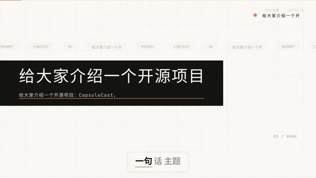
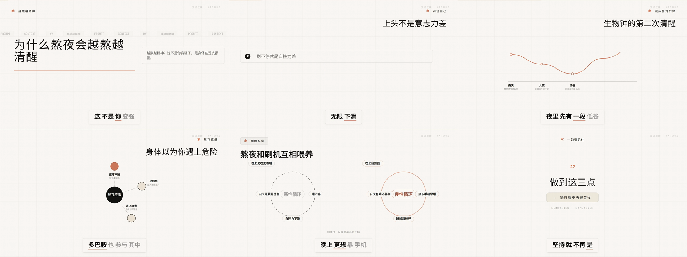
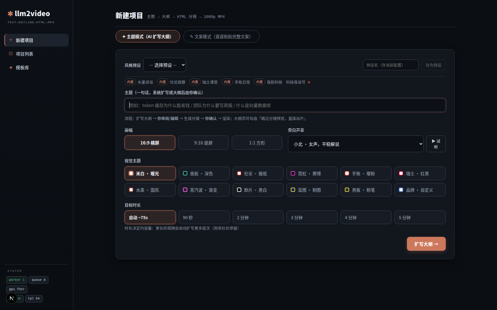
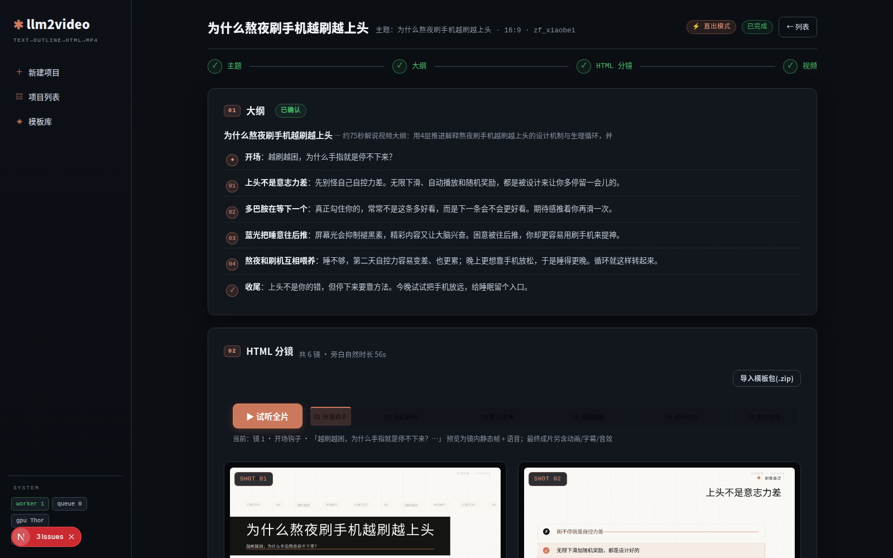

<div align="center">

# CapsuleCast 🎬

**一句话主题，自动出片。**

`主题 → AI 扩写 → 54 套 HTML 模板分镜 → 无头浏览器渲染 1080p 口播解说视频`

*Text → Faceless Video Factory*


每条成片自带「知识胶囊 · CAPSULE」铭牌——名字就是这么来的。

</div>

---

## 🎬 项目介绍视频

下面这条 60 秒介绍片，**就是用 CapsuleCast 自己渲染的**——swiss 网格风格，`diagram-flow / checklist / formula-card` 等模板混编，旁白、字幕、配乐、进度条一条不少：

<p align="center"></p>

完整版（60s · 1080p · 带旁白）：**[docs/media/capsulecast-intro.mp4](docs/media/capsulecast-intro.mp4)** —— 点开即可在 GitHub 页面直接播放。

---

## 📸 先看成片

六种模板的真实渲染帧（流程图 / 误区粉碎 / 旅程图 / 枢纽图 / 双环对比 / 金句收尾）：

<p align="center"></p>

控制台长这样（新建项目 + 项目详情 / 分镜编辑）：

<p align="center">
 
</p>

## 🧭 它是什么，适合谁

CapsuleCast 是一台**口播解说视频的自动流水线**：你说一句主题（或贴一篇文案），它产出一条带旁白、词级字幕、配乐、音效、进度条和角标的 1080p 成片。

适合：
- 知识类 / 科普类 / 观点类短视频创作者，想**批量出片**而不是逐条剪辑
- 想搭「faceless 视频」内容矩阵的人
- 想研究「LLM + 程序化视频」工程实践的开发者——本仓库沉淀了大量无头浏览器渲染管线的踩坑记录（见[开发指南](#️-开发)）

不适合：需要实拍人物、复杂转场特效的影片级内容。

## ✨ 功能全览

**创作**
- 主题模式：AI 扩写结构化大纲（json_schema 约束解码），你审阅/编辑后出片
- 文案模式：粘贴完整文案，直接分镜
- 时长模式：自然 / 舒缓 / 紧凑三档，实测成片时长分毫不差
- ⚡直出：跳过分镜预览，大纲确认后一键到成片

**视觉**
- 54 套 HTML 模板，LLM 按内容自动选型 + 字段合成（详见[模板库](#-模板库)）
- AD 艺术指导层：版式轴 / 进场方向 / 节奏按内容哈希播种——同模板每镜不同味
- 12 种视觉风格（暖纸 / 暗色 / 大报 / 杂志 / 瑞士网格 / 水墨 / 蒸汽波 / 胶片 / 蓝图 / 黑板 / 霓虹 / 品牌）
- 8 式转场轮换、逐字遮罩升起、SVG 连线生长、数字滚动、模糊聚焦等动画词汇
- 顶部进度条、创作者铭牌、logo 水印（三位置/透明度可调）、栏目 EP 角标（「栏目 · EP.03」）

**声音**
- 中文旁白 + 13 个实测可用英文音色（Kokoro TTS，单进程批量 + 内容哈希缓存）
- 词级卡拉OK字幕，三档字幕样式（standard / large / high）
- 程序化 BGM 生成 + numpy 合成音效层（whoosh / pop / ding / tick / chime，按转场、要点、章节事件自动铺设）

**运营与工程**
- A/B 对照成片：一稿渲两版（换音色 / 换风格）比数据
- 自定义模板包 zip 导入（安全 lint + 金测渲染不过自动回滚）
- 后台队列渲染 + worker 看门狗（僵死任务回收、僵尸浏览器清理）
- 每次渲染过 `hyperframes check` 四道检（lint / 运行时 / 布局 / 对比度）
- 稳定性三防线：LLM 瞬时抖动同模型重试 → 重试不济降级模型链 → 大纲零 hint 自动重试 + 显式报警

## 🎬 模板库

54 套 = `图解语义 × 23` + `数据图 × 7` + `叙事载体 × 12` + `结构与钩子 × 12`。

| 类别 | 模板 | 用在哪 |
|---|---|---|
| 图解语义 | flow · layers · cycle · quadrant · hub · pyramid · funnel · venn · tree · radar · gauge · stairs · spectrum · balance · fishbone · journey · iceberg · blocks · domino · onion · tug · swimlane · loop-duo | 流程 / 层级 / 循环 / 放射 / 因果 / 分层 / 对抗 / 协作…大纲给 `template_hint`，LLM 合成结构化字段 |
| 数据图 | bars · line · donut · table · kpi · scatter · gantt | 有数字的段落自动选型 |
| 叙事载体 | myth-buster · qa-card · checklist · rank-list · dialogue-quotes · bio-card · news-card · formula-card · price-compare · before-after · pros-cons · facts-trio | 误区粉碎 / 问答 / 自查清单 / 排行 / 引用 / 前后对比 / 利弊 / 冷知识三连 |
| 结构与钩子 | title-hook · bullet-list · big-stat · quote-cta · image-focus · free-blocks · chapter-card · process-steps · timeline-events · concept-compare · term-demo · term-explainer | 开场 / 收尾 / 万能兜底 |

**模板三件套约定**：每套模板 = `meta.json`（元信息+示例）+ `schema.json`（字段约束）+ `template.html`（Jinja + CSS + GSAP）。示例字段必须过自身 schema，动画一律 `fromTo`，可选字段必须 `fields.get()`——违反约定会被 [57 条回归测试](apps/api/tests) 拦下。

## 🏗️ 架构

```
用户 ──► Next.js 控制台 (:3300)
            │  /api/* rewrites
            ▼
        FastAPI (:8300) ──► PostgreSQL (:5433)   项目/场景/任务/日志/产物
            │        └──► Redis (:6380)          RQ 渲染队列
            ▼
        RQ Worker（看门狗：僵死任务 15min 回收 + 僵尸浏览器 30min 清理）
            ├─ 1 大纲    LLM 扩写，json_schema 约束；瞬时抖动重试 + 零 hint 自愈
            ├─ 2 分镜    启发式选模板 → LLM 字段合成（数量忠实校验）→ 规则抽取器兜底
            ├─ 3 TTS     Kokoro 批量合成 + 缓存；词级对齐 → 卡拉OK字幕
            ├─ 4 组装    HTML 模板 → HyperFrames 时间线（GSAP）
            │            AD 层注入（版式/方向/节奏）+ 进度条/铭牌/logo/EP 角标
            ├─ 5 检查    hyperframes check：lint / 运行时 / 布局 / 对比度
            └─ 6 渲染    Chrome GPU 捕获 → 1080p H.264 + 三路混音（旁白/BGM/SFX）
```

## ⚡ 快速开始

前置：Python 3.12+、Node 20+、Docker、Chrome（无头捕获；无 GPU 时自动降级软件渲染，慢但能跑）。

```bash
# 1) 基础设施（PostgreSQL :5433 + Redis :6380）
make infra

# 2) API
python -m venv .venv && source .venv/bin/activate
pip install -r apps/api/requirements.txt
cp .env.example .env        # ← 填 LLM 网关、Chrome 路径、工作目录
make api                    # :8300

# 3) 渲染 worker（另开终端，同一个 venv）
make worker

# 4) 控制台（另开终端）
cd apps/web && npm i && cd ../.. && make web   # :3300
```

打开 http://127.0.0.1:3300 ，输入主题（例如「为什么熬夜会越熬越清醒」），选风格，⚡直出——大约 2–3 分钟后回来收片。

> LLM 走 OpenAI 兼容接口：vLLM / Ollama / 内网网关 / 云端 API 都行，只要支持 `response_format` 的 json_schema 约束（不支持会自动降级，建议选支持约束解码的模型）。

## 📖 使用指南

**主题模式全流程**：新建项目选「主题」→ AI 扩写出 4 层大纲（每层带 `template_hint`）→ 编辑大纲或直接确认 → 确认时可勾 **⚡直出**（跳过分镜预览）→ 渲染完成在项目页预览/下载。

**分镜编辑器**：每个场景可改文案、换模板（下拉选全部 54 套）、改字段；「高级」里选版式变体（如 bullet-list 的三种排列）。右侧有逐镜 TTS 试听。

**A/B 成片**：渲染时勾 A/B，输出两版（换音色或换风格），对比数据后择优发布。

**栏目系列**：项目设置里填栏目名 + 集数，角标自动变「栏目 · EP.03」，全片三处同步（画面角标 / 封面 / 发布文案）。

**自定义模板包**：zip 里放若干 `模板名/`（三件套结构同上），控制台上传即用。安全 lint 拒收路径穿越 / 外链资源 / eval，金测渲染不过自动回滚——放心导入第三方包。

## 🧩 写一套自己的模板

1. 建 `templates/你的模板/`：`meta.json`（含 `example`）、`schema.json`、`template.html`
2. HTML 骨架：`{{ base_css }}` + 自有样式（`cqw/cqh` 容器单位，写竖屏断点 `@container`）
3. 动画写在首个 `<script>` 里（见下方铁律），注册 `window.__timelines["{{ scene_id }}"]`
4. 可用的共享动画库 `window.AM`：`pop / maskRise / wipe / focus / draw / countUp / kenburns / pulse / shimmer / float / exitSoft`
5. 到 `outline.py` 的 `TEMPLATE_HINTS` + 教学文案、`llm.py` 的 `DIAGRAM_TIDS`、`storyboard.py` 的启发式里登记你的模板
6. `pytest apps/api/tests -q` 全绿即入库

## 🛠️ 开发

```bash
make e2e                        # 本地端到端（不经 API/DB）
pytest apps/api/tests -q        # 57 条回归
make status / make logs / make stop
```

**HF 运行时铁律**（都是踩过的坑，回归测试有对应守卫）：

- 帧模板的**首个 `<script>` 之外的内联脚本不会执行**——注入代码必须缝进首个 script（AD 层就是这么做的）
- GSAP 动画一律 `fromTo`：裸 `to()` 在逐帧 seek 捕获下惰性起点不可靠
- `.hf-safe` 及其直接子元素是 HF 托管/投影层，**opacity 动画打稳定 id 的深叶子**（`#s-…-kicker` 这类），别打容器
- 禁 `left/top` tween（整数像素吸附）、禁 `letterSpacing` tween、禁 `fields.items`（dict 方法遮蔽，用 `fields.get('items')`）
- 生成的 SVG 文字节点必须走支持 text 参数的 `el()` 助手
- f-string 多段拼接时续段没有 f 前缀，`}}` 是两个字面量

## ⚙️ 配置参考

| 变量 | 说明 |
|---|---|
| `DATABASE_URL` / `REDIS_URL` | PG 与 Redis 连接串 |
| `APP_ROOT` | 仓库根目录（模板从这里读） |
| `WORK_DIR` | 渲染工作目录（大文件，建议放仓库外） |
| `HF_CLI_VERSION` | HyperFrames CLI 版本 |
| `HYPERFRAMES_BROWSER_PATH` | Chrome / headless-shell 路径 |
| `HF_RENDER_WORKERS` | 渲染并行度（每 worker 一个 Chrome） |
| `HF_RENDER_QUALITY` | `draft / looks / delivery` |
| `LLM_BASE_URL` / `LLM_API_KEY` / `LLM_MODEL` | OpenAI 兼容接口；网关可用模型自动组成降级链 |
| `LLM_TIMEOUT_S` | 单次 LLM 请求超时 |
| `HTTP_PROXY` / `NO_PROXY` | 外网代理；本地/内网自动直连 |

## 📊 实测

- 硬件：NVIDIA Thor（ARM aarch64，14 核）——本管线从 TTS 到渲染全链路在 ARM 上跑通，x86 只会更快
- 60s 成片端到端 ≈ **2–3 分钟**（6 workers，Chrome GPU 捕获）；无 GPU 软件渲染约 ×3
- 时长忠实度：目标 90s 出片 90.0s
- 57 条回归测试；每次渲染过 hyperframes 四道检

## 🗺️ Roadmap

- [ ] hub / cycle 节点字号自适应（小字已知刺）
- [ ] 高频模板更多版式变体（现 bullet×3 / title×3 / quote×2 / stat×2）
- [ ] loop-duo 节点呼吸间距微调
- [ ] 封面模板自定义
- [ ] 成片自动发布（抖音 / B 站 / YouTube API）

## ❓ FAQ

**必须中文内容吗？** 旁白/字幕/模板对中文优化，但英文主题可全英文出片（13 个实测英文音色）。字幕分词对英文天然成组。

**没 GPU 能跑吗？** 能。Chrome 捕获自动降级软件渲染，慢 3 倍左右。

**必须接 LLM 吗？** 强烈建议。不接会退化到脚手架大纲 + 规则分镜，能出片但选型生硬。

**模板能商用吗？** 模板是你自己的 HTML/CSS，随便改随便商用。仓库整体 License 待定（倾向 MIT，定了会更新）。

## 🙏 致谢

- [HyperFrames](https://www.npmjs.com/package/hyperframes) — 时间线与渲染管线
- [GSAP](https://gsap.com) — 动画引擎
- [Kokoro TTS](https://huggingface.co/hexgrad/Kokoro-82M) — 旁白合成

---

<div align="center">

**CapsuleCast** · 一句话主题，自动出片

⭐ 如果它帮到了你，点个星让更多人看到

</div>
